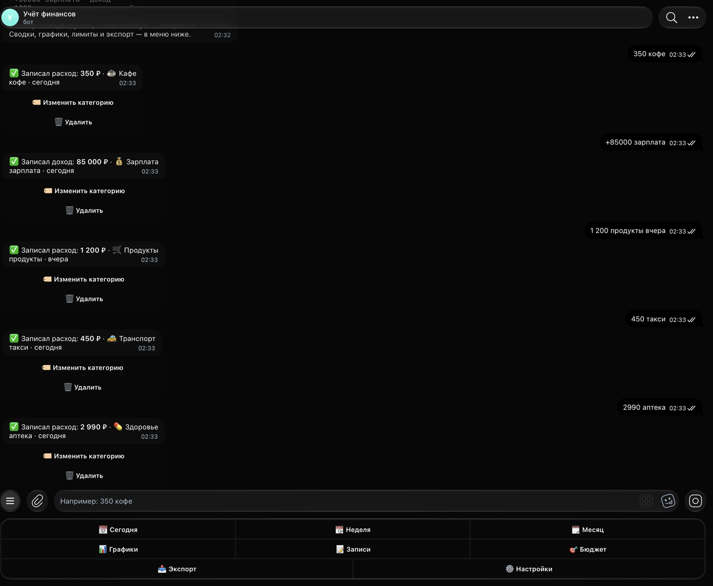
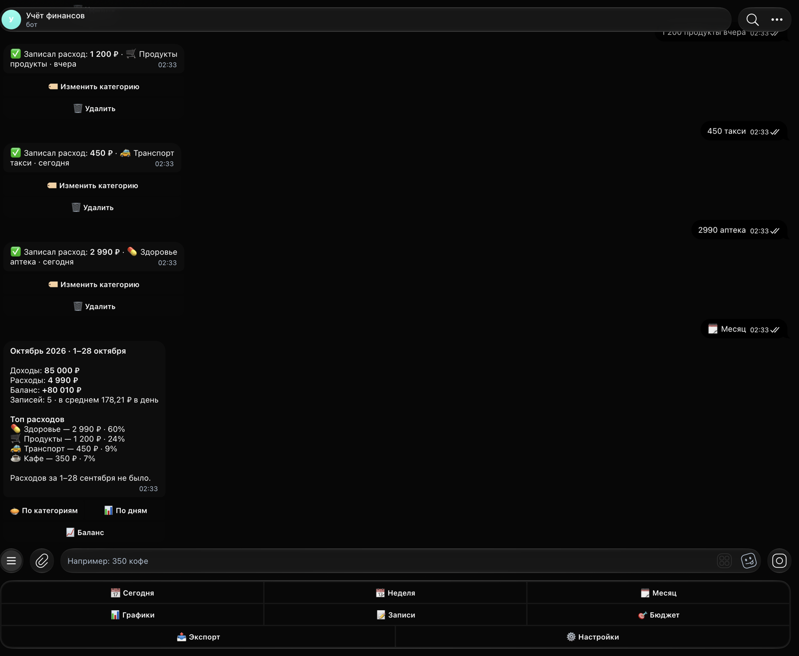
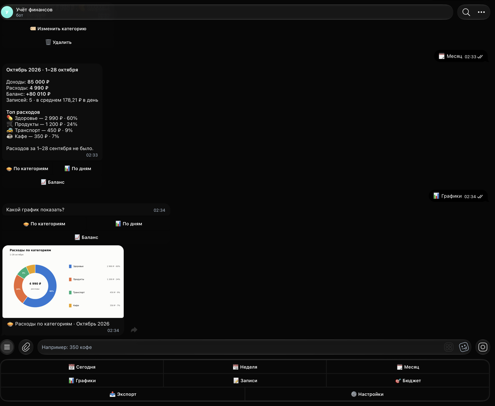

# Учёт финансов — Telegram-бот

Бот для учёта личных расходов и доходов прямо в чате: пишешь «350 кофе» — он сам определяет категорию, считает сводки, рисует графики, следит за лимитами и выгружает данные в Excel.

Демо: [@fin_ledger_demo_bot](https://t.me/fin_ledger_demo_bot)

Демо для портфолио: суммы, категории и записи в примерах вымышленные.

## Что умеет

- Быстрая запись обычным текстом: сумма, знак, описание и дата в одной строке. Несколько записей — с новой строки.
- Автоматическая категория по словарю ключевых слов (кофе → Кафе, метро → Транспорт, аптека → Здоровье и т. д.). Категорию можно поменять кнопкой сразу после записи — бот запомнит выбор для таких же описаний.
- 16 категорий расходов и 8 категорий доходов с эмодзи, плюс свои категории.
- Сводки за сегодня, неделю и месяц: доходы, расходы, баланс, средние траты в день, топ категорий с долями, сравнение с тем же отрезком прошлого периода.
- Графики: круг по категориям за месяц, столбики расходов по дням за 30 дней, линия накопленного баланса. Присылаются картинкой в едином стиле.
- Лимиты бюджета по категориям на месяц: предупреждение при 80% и при превышении, прогресс-бары в разделе «Бюджет».
- Отмена последней записи, список последних записей с редактированием (сумма, описание, категория, дата, тип) и удалением.
- Экспорт в CSV и Excel (XLSX) за месяц, прошлый месяц, 3 месяца или всё время.
- Настройки: валюта, смещение часового пояса, ежедневное напоминание «запиши траты» в выбранное время (можно выключить).
- Многопользовательский: данные каждого пользователя хранятся отдельно в SQLite.

## Что понимает бот

| Сообщение | Результат |
|---|---|
| `350 кофе` | расход 350, категория Кафе |
| `-350 кофе` | то же самое |
| `+50000 зарплата` | доход 50 000, категория Зарплата |
| `зарплата 80000` | доход: слова «зарплата», «аванс», «премия», «кэшбэк» бот считает доходом и без плюса |
| `1 200,50 продукты` | сумма с пробелами и копейками |
| `2к такси` | «к» или «тыс» — тысячи |
| `450р обед`, `450 руб. обед` | обозначение валюты игнорируется |
| `350 кофе вчера` | дата — вчера |
| `3000 стоматолог 05.03` | дата — 5 марта; если число ещё не наступило, берётся прошлый год |
| `кофе 350` | сумма может стоять в любом месте |
| `350 кофе` + `120 метро` (в две строки) | две записи одним сообщением |
| `отменить последнюю` | то же, что /undo |

## Команды

| Команда | Что делает |
|---|---|
| /start | меню и короткая инструкция |
| /help | примеры записей и список команд |
| /today, /week, /month | сводка за период с кнопками графиков |
| /charts | выбор графика |
| /list | последние записи, правка и удаление |
| /undo | отменить последнюю запись |
| /budget | лимиты по категориям |
| /export | выгрузка в CSV или XLSX |
| /settings | валюта, часовой пояс, напоминание, категории |
| /cancel | прервать ввод |
| /stats | статистика бота, только для `ADMIN_IDS` |

## Стек

Python 3.9+, aiogram 3.22, aiosqlite (SQLite), matplotlib (графики), openpyxl (XLSX), python-dotenv, pytest. Docker и systemd для развёртывания.

## Скриншоты

<!-- screens -->

Запись «350 кофе» с подобранной категорией и кнопками «Изменить категорию» и «Удалить».


Сводка /month: доходы, расходы, баланс, топ категорий и сравнение с прошлым месяцем.


Круговая диаграмма расходов по категориям за месяц и раздел «Бюджет» с прогресс-барами.

## Запуск локально

```bash
pip install -r requirements.txt
cp .env.example .env   # вписать BOT_TOKEN от @BotFather и свой Telegram id в ADMIN_IDS
python main.py
```

База создаётся автоматически в `data/finance.db` (путь меняется в `DB_PATH`).

## Запуск в Docker

```bash
cp .env.example .env
docker compose up -d --build
```

База хранится в папке `./data` на хосте.

## Запуск на VPS через systemd

```bash
sudo git clone https://github.com/malishq/finance-tracker-bot /opt/finance-tracker-bot
cd /opt/finance-tracker-bot
sudo python3 -m venv .venv && sudo .venv/bin/pip install -r requirements.txt
sudo cp .env.example .env && sudo nano .env
sudo cp deploy/finance-bot.service /etc/systemd/system/
sudo systemctl enable --now finance-bot
```

Unit-файл ожидает пользователя `bot` и папку `/opt/finance-tracker-bot`; логи — `journalctl -u finance-bot -f`.

## Тесты

```bash
pytest
```

Покрыто: парсер записей (20+ примеров), подбор категорий, сводки и сравнение периодов, границы периодов, бюджеты, экспорт CSV/XLSX, графики, расчёт напоминаний и сквозные сценарии бота на подменённой сессии Telegram (без сети).

## Как адаптировать под клиента

- Категории и эмодзи — список `DEFAULT_CATEGORIES` в `bot/services/categories.py`, ключевые слова для автоподбора — словарь `KEYWORDS` там же (стемы слов, можно дописывать).
- Тексты сообщений — `bot/texts.py` и строки в `bot/handlers/*.py`; названия кнопок меню — `bot/keyboards.py`.
- Валюта и часовой пояс по умолчанию для новых пользователей — `DEFAULT_CURRENCY` и `DEFAULT_TZ_OFFSET` в `.env`; каждый пользователь меняет их в настройках.
- Порог предупреждения о лимите (80%) — `WARNING_SHARE` в `bot/services/budgets.py`; окно напоминания — `WINDOW_MINUTES` в `bot/services/reminders.py`.
- Стиль графиков (цвета, шрифт, размер) — константы в начале `bot/services/charts.py`.
- Хранилище — SQLite через `bot/db.py`; для PostgreSQL достаточно заменить этот модуль, остальная логика от базы не зависит.

Названия категорий, ключевые слова и тексты — примерные данные, их можно менять под задачу.

## Структура проекта

```
main.py              точка входа, регистрация команд и роутеров
bot/config.py        настройки из .env
bot/db.py            SQLite: пользователи, записи, категории, лимиты, правила
bot/keyboards.py     меню и inline-клавиатуры
bot/handlers/        обработчики: записи, отчёты, история, бюджет, экспорт, настройки
bot/services/        чистая логика без aiogram: парсер, категории, сводки, графики, экспорт
bot/reminders.py     фоновая задача напоминаний
tests/               pytest
deploy/              unit-файл systemd
```
